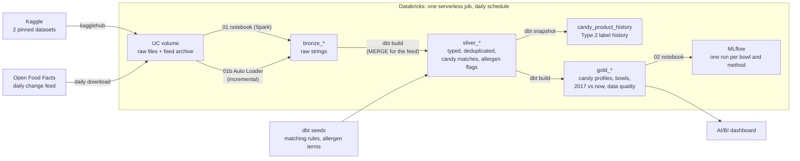

# CandyOps

[](https://github.com/kidskoding/candyops/actions/workflows/ci.yml)

A Databricks and dbt pipeline that finds which popular Halloween candies are safe for children with common food
allergies. It joins a candy popularity vote with a crowdsourced database of 356,001 packaged foods, both public Kaggle
datasets, and builds a 10-candy bowl for each allergy along with the share of popularity that each restriction costs.
A daily incremental load of the Open Food Facts change feed then checks whether the 2017 answer still holds for the
labels on shelves now.

> [!WARNING]
> Allergen flags are parsed from crowdsourced ingredient lists. They are not medical advice and may be out of date.
> Always read the package label.

## Contents

- [Data](#data)
- [Results](#results)
- [How it works](#how-it-works)
- [Getting started](#getting-started)
- [CI/CD](#cicd)
- [Limitations](#limitations)
- [Project layout](#project-layout)

## Data

| Kaggle dataset | License | Contents | Data-quality issues |
|---|---|---|---|
| [`fivethirtyeight/the-ultimate-halloween-candy-power-ranking`](https://www.kaggle.com/datasets/fivethirtyeight/the-ultimate-halloween-candy-power-ranking) | MIT | Win rates for 85 candies from about 269,000 head-to-head votes | Apostrophes are mis-encoded (`HersheyÕs`), and two entries are coins, not candy |
| [`openfoodfacts/world-food-facts`](https://www.kaggle.com/datasets/openfoodfacts/world-food-facts) | ODbL | Ingredients, allergens, sugar and serving size for packaged foods | About 1 GB of TSV with 356,001 rows and 163 columns; stray carriage returns, fields over 131,000 characters, many languages, and mostly empty allergen fields |

Both datasets are 2017 snapshots, and the pipeline pins their Kaggle versions. A third, live source keeps the answer
current:

| Live source | License | Contents | Constraint |
|---|---|---|---|
| [Open Food Facts daily change feed](https://static.openfoodfacts.org/data/delta/index.txt) | ODbL | One gzipped JSON file per day with every product edited that day (about 100,000 products in two weeks) | Upstream keeps only about two weeks of files, so a missed window is lost unless it was archived |

## Results

Each bowl holds the 10 most popular candies whose labels list none of the restricted allergens. "Popularity retained"
compares a bowl's average win rate with that of the unrestricted bowl.

| Restriction | Eligible candies | Popularity retained |
|---|---|---|
| None | 83 | 100.0% |
| Gluten-free | 37 | 88.2% |
| Peanut-free | 43 | 78.0% |
| Nut-free | 41 | 77.1% |
| Milk-free | 30 | 74.6% |
| Free of all six allergens | 18 | 68.7% |

Matching candies to products by name alone links 53 candies but also pulls in 80 products that are not candy, such as
coffee creamer, ice cream and cereal. The curated matching rules link 68 candies with no non-candy matches.

### Is the 2017 answer still true?

The first two weeks of the daily change feed held 98,694 product edits, 348 of them for ranked candies. Twenty-one
candies had at least two current products with ingredient lists, enough to compare with 2017:

| Each candy, 2017 vs now | Candies |
|---|---|
| At least one allergen status changed | 12 |
| All compared allergens unchanged | 7 |
| Newly covered (too little 2017 data) | 2 |
| Not enough current data yet | 62 |

Butterfinger had no usable 2017 data; current labels show peanuts, milk and soy, which confirms the guard that keeps
peanut-tagged candies out of nut-free bowls. Snickers and Milky Way moved from `varies` to `contains` for egg. The bowls
stay on the pinned 2017 data, and the comparison grows as the daily job archives more of the feed.

The full bowls, the allergen status of every candy and the cleaning metrics are in
[`docs/results.md`](docs/results.md), which `scripts/write_results.py` regenerates from the gold tables.

## How it works



### Bronze

[`notebooks/01_kaggle_to_bronze.py`](notebooks/01_kaggle_to_bronze.py) downloads both pinned datasets into a Unity
Catalog volume, which caches them between runs, and loads every column unchanged as a string. The TSV is split on
`\n` only. Twenty-six rows contain a stray `\r` that pandas and the default CSV readers treat as a line break, which
would produce 356,027 rows instead of 356,001. A dbt test pins both row counts.

### Change feed (incremental)

[`notebooks/01b_change_feed_to_bronze.py`](notebooks/01b_change_feed_to_bronze.py) runs daily. It archives each new
feed file into the volume, so files stay after they expire upstream, and loads them with Auto Loader
(`trigger(availableNow=True)`). The checkpoint guarantees each file is appended to `bronze_off_changes` exactly once,
however often the job runs. [`silver_product_changes`](dbt/models/silver/silver_product_changes.sql) is an incremental
dbt model that reads only rows newer than its last run and `MERGE`s them on barcode, keeping the latest edit. The
[`candy_product_history`](dbt/snapshots/candy_product_history.sql) snapshot records every label edit of a candy product
as a Type 2 history row. A dbt test warns when consecutive archived files leave a gap.

### Silver

- [`silver_products`](dbt/models/silver/silver_products.sql) trims all whitespace, casts types, parses serving sizes
  such as `"1 bar (45 g)"` and `"1.55 oz"`, drops impossible sugar values, and keeps one row per barcode (the pinned file has no duplicates once
  parsed correctly; the rule guards later versions).
- [`silver_candy_matches`](dbt/models/silver/silver_candy_matches.sql) links each ranked candy to its products using
  hand-written regular expressions stored as a seed ([`candy_aliases.csv`](dbt/seeds/candy_aliases.csv)). It first
  filters out lookalikes such as Almond Joy coffee creamer.
- [`silver_product_allergens`](dbt/models/silver/silver_product_allergens.sql) detects six allergens in English,
  French and German ingredient text. It separates "may contain" warnings from ingredients and ignores phrases such as
  "cocoa butter" and "peanut-free".

### Gold

Each candy receives one of five statuses per allergen: `contains`, `varies`, `may_contain`, `not_listed` or
`unknown`. US products alone decide when at least three of them have ingredient lists, because US and European
recipes of the same bar differ. With fewer, all countries count: two junk US records (a popcorn listing named
"Snickers" and a wrapper scan of customer-service text) once outvoted 25 proper Snickers labels. Mixed packs and
variety packs are excluded, because their allergens belong to other candies.

A bowl takes the 10 most popular candies that are `not_listed` for every restricted allergen. The peanut-free and
nut-free bowls also exclude every candy that the ranking itself tags as containing peanuts or almonds. This guard
exists because Butterfinger once entered the peanut-free bowl: its only matched products with ingredient lists were a
caramel apple and marshmallow squares made with it.

`gold_match_methods` compares name-only matching with the curated rules and shows why the rules are necessary.
`gold_label_changes` puts each candy's 2017 status next to its status in the products edited since the feed started.
The bowls stay on the pinned 2017 data, so they are reproducible.

### MLflow

[`notebooks/02_mlflow_and_summary.py`](notebooks/02_mlflow_and_summary.py) logs one nested run per bowl and per
matching method, with the dataset versions recorded as parameters.

### Tests

`dbt build` runs every model with its tests: keys, relationships, accepted values, value ranges, pinned row counts, a
check that every candy in a restricted bowl is safe, a check that no peanut or almond candy reaches a nut-free bowl, a
check that every ranked candy has a matching rule, and a warning when the change-feed archive has a gap.

## Getting started

### Prerequisites

- [uv](https://docs.astral.sh/uv/), which installs Python 3.11 or later and the project dependencies
- [Databricks CLI](https://docs.databricks.com/dev-tools/cli/install.html) and a Databricks workspace (Free Edition
  works), for running the pipeline

### Run the local checks

The local checks need no Databricks workspace. They run the linter, the unit tests for the seed regular expressions
and the MLflow logging, and `dbt parse`.

```bash
uv sync --group dbt
uv run ruff check .
uv run pytest
cd dbt && DATABRICKS_HOST=x DBT_HTTP_PATH=x DATABRICKS_TOKEN=x uv run dbt parse --profiles-dir profiles
```

### Run on Databricks

[`databricks.yml`](databricks.yml) defines the pipeline job and the AI/BI dashboard. The `dev` target writes to the
`candyops_dev` schema.

```bash
databricks auth login --host https://<your-workspace>.cloud.databricks.com
databricks bundle deploy -t dev
databricks bundle run -t dev candyops_pipeline
uv run python scripts/write_results.py --schema candyops_dev
```

The job runs three tasks in order:

1. `kaggle_to_bronze`, a notebook that loads the raw data
2. `dbt_build`, a dbt task on the Serverless Starter Warehouse
3. `mlflow_summary`, a notebook that logs the results to MLflow

It writes only `bronze_*`, `silver_*` and `gold_*` tables and the `raw` volume inside the project schema.

### Run dbt from a laptop

Set `DATABRICKS_HOST`, `DATABRICKS_TOKEN` and `DBT_HTTP_PATH=/sql/1.0/warehouses/<id>`, then run the following
inside `dbt/`:

```bash
uv run dbt build --profiles-dir profiles
```

## CI/CD

| Workflow | Trigger | Steps |
|---|---|---|
| [`ci.yml`](.github/workflows/ci.yml) | Every push and pull request | Ruff; pytest on Python 3.11 and 3.12; a check that the dashboard JSON matches [`scripts/build_dashboard.py`](scripts/build_dashboard.py); `dbt parse`; and `dbt build` on Databricks in a separate `candyops_ci` schema that reads the deployed bronze tables |
| [`deploy.yml`](.github/workflows/deploy.yml) | CI success on `main` | Validates, deploys and runs the bundle's `prod` target |

The deploy workflow needs the repository variable `DATABRICKS_HOST` and the secret `DATABRICKS_TOKEN`. Use a
short-lived personal access token.

## Limitations

- Both datasets are 2017 snapshots. Recipes have changed since then, and the product database has grown.
- Open Food Facts is crowdsourced. Many popular US bars have few or no US records in this snapshot, so some candies
  are `unknown` and some statuses rely on European recipes. The dashboard and the results show the evidence count for
  each candy.
- The allergen parser is keyword-based. It handles common English, French and German terms, negations and "may
  contain" phrases, but not every possible wording. A candy counts as safe only when every restricted allergen is
  `not_listed` on at least two products, so gaps in the data exclude candies rather than wrongly include them.
- Popularity comes from an online vote, not from sales data.
- The change feed holds only products edited since the archive started, not a full current database, so the 2017 vs
  now comparison covers only candies with at least two edited products that have ingredient lists. The feed is more
  international than the 2017 file, and the parser does not read every language (for example Spanish "puede
  contener" or Polish ingredient words), so some current statuses miss warnings.

## Project layout

```
notebooks/       01_kaggle_to_bronze.py, 01b_change_feed_to_bronze.py, 02_mlflow_and_summary.py
dbt/             dbt project: seeds (matching rules), silver and gold models, snapshots, tests, macros, profiles
src/candyops/    configuration, Kaggle download, change-feed file parsing, MLflow tracking, Spark I/O
dashboards/      candyops.lvdash.json, generated by scripts/build_dashboard.py
scripts/         build_dashboard.py, write_results.py
docs/            results.md, generated from the Databricks gold tables
tests/           pytest: seed regular expressions on real product text, feed gaps, MLflow logging
databricks.yml   asset bundle: daily pipeline job and dashboard
```
