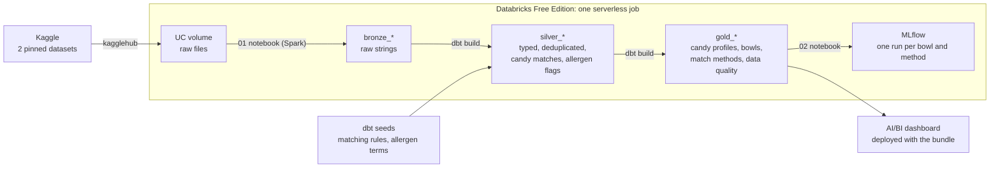

# candyops

[](https://github.com/kidskoding/candyops/actions/workflows/ci.yml)

**Which Halloween candy can every kid eat? A Databricks + dbt pipeline over public Kaggle data.**

A trick-or-treat bowl should hold the candy kids actually want, but many popular candies contain peanuts, tree nuts,
milk or wheat, and some trick-or-treaters are allergic to them. CandyOps answers one question:

> For each common allergy, which 10 popular candies can a host hand out, and how much popularity does the
> restriction cost?

It joins two public datasets that were never meant to meet:

| Kaggle dataset | What it gives | Size and mess |
|---|---|---|
| [`fivethirtyeight/the-ultimate-halloween-candy-power-ranking`](https://www.kaggle.com/datasets/fivethirtyeight/the-ultimate-halloween-candy-power-ranking) (MIT) | How often each of 85 candies won about 269,000 head-to-head votes | Tiny, but its apostrophes are mojibake (`HersheyÕs`) and two "candies" are coins |
| [`openfoodfacts/world-food-facts`](https://www.kaggle.com/datasets/openfoodfacts/world-food-facts) (ODbL) | Ingredients, allergens, sugar and serving size of packaged foods | ~1 GB TSV, 356,001 products x 163 columns, crowdsourced: duplicate barcodes, stray carriage returns, fields over 131k characters, many languages, mostly empty allergen fields |

Results (bowls, popularity kept, every candy's allergen status) are in [`docs/results.md`](docs/results.md),
regenerated from the Databricks gold tables.

> Allergen flags are parsed from crowdsourced ingredient lists from 2017. They are not medical advice and can be out of
> date: always read the package label.

## Architecture



1. **Bronze (Python + Spark).** [`notebooks/01_kaggle_to_bronze.py`](notebooks/01_kaggle_to_bronze.py) downloads both
   pinned Kaggle versions into a Unity Catalog volume (cached on reruns) and loads them unchanged as strings. The TSV
   is split on `\n` only: 26 rows contain a stray `\r` that pandas and default CSV readers treat as a new line, which
   would give 356,027 rows instead of 356,001. A dbt test pins both row counts.
2. **Silver (dbt).** [`silver_products`](dbt/models/silver/silver_products.sql) trims every kind of whitespace, casts
   types, parses serving sizes (`"1 bar (45 g)"`, `"1.55 oz"`), drops impossible sugar values and keeps the latest edit
   of each duplicated barcode. [`silver_candy_matches`](dbt/models/silver/silver_candy_matches.sql) links each ranked
   candy to its products with hand-written regex rules kept as a seed
   ([`candy_aliases.csv`](dbt/seeds/candy_aliases.csv)), after filtering out lookalikes such as "Almond Joy" coffee
   creamer. [`silver_product_allergens`](dbt/models/silver/silver_product_allergens.sql) reads six allergens from the
   ingredient text in English, French and German, separates "may contain" warnings from ingredients, and ignores
   phrases like "cocoa butter" or "peanut-free".
3. **Gold (dbt).** Per candy and allergen: `contains`, `varies`, `may_contain`, `not_listed` or `unknown`, using US
   products when there are at least two with ingredients (US and European recipes of the same bar differ). Bowls take
   the 10 most popular candies that are `not_listed` for every restricted allergen. Peanut-free and nut-free bowls
   also drop every candy the ranking itself tags as peanut/almond: Butterfinger once slipped into the peanut-free bowl
   because its only matches with ingredient lists were a caramel apple and marshmallow squares "made with" it. `gold_match_methods` shows why the
   curated rules exist: matching on the name alone pulls in creamers, ice cream and cereal.
4. **MLflow.** [`notebooks/02_mlflow_and_summary.py`](notebooks/02_mlflow_and_summary.py) logs one nested run per bowl
   and per matching method, with the dataset versions as parameters.

`dbt build` runs every model and its tests: keys, relationships, accepted values, value ranges, pinned row counts,
"every candy in a restricted bowl is safe", and "every ranked candy has a matching rule".

## Run it

**Locally (no Databricks):** lint, unit tests for the seed regex rules and the MLflow logging, and a dbt parse.

```bash
uv sync --group dbt
uv run ruff check .
uv run pytest
cd dbt && DATABRICKS_HOST=x DBT_HTTP_PATH=x DATABRICKS_TOKEN=x uv run dbt parse --profiles-dir profiles
```

**On Databricks Free Edition (Asset Bundle):**

```bash
databricks auth login --host https://<your-workspace>.cloud.databricks.com
databricks bundle deploy -t dev        # job + dashboard, schema candyops_dev
databricks bundle run -t dev candyops_pipeline
uv run python scripts/write_results.py --schema candyops_dev
```

The job runs `kaggle_to_bronze` (notebook) → `dbt_build` (dbt task on the Serverless Starter Warehouse) →
`mlflow_summary` (notebook). It writes only `bronze_*`, `silver_*` and `gold_*` tables and the `raw` volume inside the
project schema.

**dbt against your workspace from a laptop:** set `DATABRICKS_HOST`, `DATABRICKS_TOKEN` and
`DBT_HTTP_PATH=/sql/1.0/warehouses/<id>`, then `uv run dbt build --profiles-dir profiles` inside `dbt/`.

## CI/CD

* **CI** ([`ci.yml`](.github/workflows/ci.yml)) on every push and pull request: ruff, pytest on Python 3.11 and 3.12,
  a check that the dashboard JSON matches [`scripts/build_dashboard.py`](scripts/build_dashboard.py), `dbt parse`, and
  `dbt build` on Databricks into a separate `candyops_ci` schema, reading the deployed bronze tables.
* **CD** ([`deploy.yml`](.github/workflows/deploy.yml)) after CI passes on `main`: validates, deploys and runs the
  bundle's `prod` target. It needs the repository variable `DATABRICKS_HOST` and the secret `DATABRICKS_TOKEN`
  (a short-lived personal access token).

## Limitations

* Both datasets are 2017 snapshots. Recipes change, and the product database has since grown.
* Open Food Facts is crowdsourced. Many popular US bars have few or no US records in this snapshot, so some candies are
  `unknown` and some statuses rest on European recipes. The dashboard and results show the evidence count for each.
* The allergen parser is keyword-based. It handles common English, French and German terms, negations and
  "may contain" phrases, not every phrasing. A candy counts as safe only when every restricted allergen is
  `not_listed` on at least two products, so gaps exclude candies rather than wrongly include them.
* Popularity comes from an online vote, not sales.

## Repository layout

```
notebooks/      01_kaggle_to_bronze.py, 02_mlflow_and_summary.py (Databricks source format)
dbt/            dbt project: seeds (rules), models/silver, models/gold, tests, macros, profiles/
src/candyops/   config, sources (Kaggle download + reader options), tracking (MLflow), spark_io
dashboards/     candyops.lvdash.json, generated by scripts/build_dashboard.py
scripts/        build_dashboard.py, write_results.py
docs/           results.md (generated from Databricks)
tests/          pytest: seed regex rules on real product text, MLflow logging
databricks.yml  asset bundle: job (notebook -> dbt -> notebook) and dashboard
```
