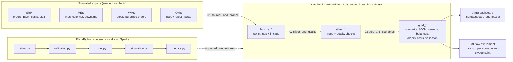

# candyops

[](https://github.com/kidskoding/candyops/actions/workflows/ci.yml)

**Halloween Manufacturing Analytics with Databricks**

> **Synthetic data disclosure**: CandyOps is a demonstration. Every factory, retailer, order, cost, and quantity is
> fictional and comes from a seeded generator. The source feeds are **simulated** ERP, MES, WMS/procurement, and
> QMS exports. They are not SAP, Oracle, or any other real integrations!! The project is not affiliated with any
> confectionery company and does not reflect any company's internal systems or data. All results are modeled
> outcomes. They are not observed losses or real savings.

## The business story

It is **October 27, 2026**. A fictional confectionery maker is packing Halloween assortment bags for retailer orders that
must be **ready to ship before Halloween**. At 06:00 the bag sealer on **Northfield packaging line A1** fails.
Maintenance estimates the line will be back at **Oct 29, 14:00**.

The planner must decide:

> Should we use overtime, move production to the Southgate factory, or accept a shortfall? What can actually be
> ready before the Halloween shipping cutoff?

Halloween drives the model:

* Each order has a ready-to-ship deadline between Oct 27 and Oct 30. Bags finished after the deadline cannot rescue that order.
* Each SKU needs its own printed Halloween bag film. This film is a constrained material, especially at Southgate.
* Halloween-packed bags left after Oct 31 are reported as **seasonal inventory exposure**. The 50% markdown is an
  explicit assumption, shown separately, and never added to recovery cost.

## What it does

| Source area (simulated) | Data |
|---|---|
| ERP | customer orders, production orders, recipes (BOM), material costs, products, cost parameters |
| MES | lines, rates and yields, line calendar, downtime events, production actuals |
| Inventory & procurement | opening ingredient / film / finished-goods stock, supplier purchase orders with arrival dates |
| Production & quality | batch output, good bags, rejects, scrap kg |

Scope: 2 factories, 3 lines, 3 SKUs, 12 retailer orders, and 7 daily periods (Oct 25–31). Oct 25–26 are actuals, and the breakdown
starts Oct 27. Every scenario restarts from the **same** decision-point state:

| Scenario | Meaning |
|---|---|
| `S0_REFERENCE_NO_BREAKDOWN` | Counterfactual only. It shows which orders the breakdown puts at risk |
| `S1_NO_RECOVERY` | Disrupted original schedule, with no recovery |
| `S2_OVERTIME` | Limited overtime (≤4 h per line-day) at Northfield, on lines that are running |
| `S3_TRANSFER` | Southgate's idle standard hours make eligible SKUs, which are trucked to Northfield (1-day lead time) |
| `S3B_TRANSFER_EARLY_WRAPPERS` | Sensitivity check: S3 with Southgate's Halloween film delivered Oct 27 instead of Oct 30 |
| `S4_OVERTIME_AND_TRANSFER` | Overtime first, then Southgate's idle hours for whatever is still short |

**Sweeps** rerun the options from the same Oct 27 state with one input changed: the Southgate film delivery date
(Oct 27–30) and the Northfield overtime cap (0–8 h per line-day). Results land in `gold_sweep`, and every scenario and
sweep point is logged as a run in an **MLflow** experiment (`/Users/<you>/candyops-scenarios`) for side-by-side comparison.

**Actual results** (local run, regenerated by `scripts/run_local.py`) are in [`docs/results.md`](docs/results.md).

## Architecture



* **Notebook 01** generates the source exports and writes `bronze_*` Delta tables.
* **Notebook 02** casts types, splits downtime events into line-day hours, runs 86 data-quality checks
  (keys, references, units, ranges, timestamps, MES↔QMS reconciliation), and writes `silver_*` plus `silver_quality_checks`.
* **Notebook 03** reads silver, runs the scenarios, sensitivity check and sweeps, runs 284 model-integrity checks, writes `gold_*`, and logs
  every run to MLflow.
* Spark handles I/O and SQL. The simulation is plain Python, so the same code runs locally under `pytest`.

## Run locally (uv)

```bash
uv sync                               # Python 3.11 venv + pytest
uv run ruff check .                   # lint
uv run pytest                         # 29 tests, including a hand-checkable example
uv run python scripts/run_local.py    # writes out/*.csv and regenerates docs/results.md
# optional, needs Java 17+: local Spark + Delta smoke test of the notebook flow
uv run --group spark python scripts/spark_smoke.py
```

## Run on Databricks Free Edition

**Option A: click through it (no setup)**

1. In Databricks, go to **Workspace → Create → Git folder** and paste `https://github.com/kidskoding/candyops.git`.
2. Open `notebooks/01_sources_and_bronze`, attach **Serverless** compute, and click **Run all**.
3. Run `02_silver_and_quality`, then `03_gold_and_scenarios`. Keep the `catalog` (`workspace`) and `schema`
   (`candyops`) widgets the same in all three.
4. Build the dashboard with [`docs/dashboard_setup.md`](docs/dashboard_setup.md) and [`sql/dashboard_queries.sql`](sql/dashboard_queries.sql).

**Option B: one job from your terminal (Databricks Asset Bundle)**

[`databricks.yml`](databricks.yml) defines one job, `candyops-pipeline`, that runs the three notebooks in order on
serverless compute.

```bash
databricks auth login --host https://<your-workspace>.cloud.databricks.com
databricks bundle deploy -t dev
databricks bundle run -t dev candyops_pipeline
```

**How the import works:** each notebook adds `<repo>/src` to `sys.path` (the notebook's working directory is its own
folder, so the repo root is `..`). It also clears cached `candyops` modules, so reruns pick up code edits. If your layout
differs, set the `repo_root` widget to the absolute workspace path, for example `/Workspace/Users/<you>/candyops`.

**Rerun safety:** the notebooks only `CREATE SCHEMA IF NOT EXISTS` and overwrite tables named `bronze_*`, `silver_*`, or
`gold_*` inside the project schema. Identifiers are validated before they reach SQL. The same seed always gives the same tables.

## CI/CD

* **CI** ([`.github/workflows/ci.yml`](.github/workflows/ci.yml)) runs on every push and pull request:
  ruff, pytest on Python 3.10–3.12, a check that the committed `docs/results.md` still matches the simulation,
  and a local Spark + Delta run of the notebook flow and every dashboard query.
* **CD** ([`.github/workflows/deploy.yml`](.github/workflows/deploy.yml)) runs after CI passes on `main`. It validates,
  deploys, and runs the bundle's `prod` target in your workspace. It is skipped until you add, under
  **Settings → Secrets and variables → Actions**:
  * Variable `DATABRICKS_HOST`: your workspace URL
  * Secret `DATABRICKS_TOKEN`: a Databricks personal access token (**Settings → Developer → Access tokens**).
    Give it a short lifetime and rotate it.

## Modeling rules (summary)

Daily event sequence: (1) supplier receipts → (2) transfer arrivals → (3) production (baseline → overtime → transfer)
→ (4) good output to stock or onto a truck → (5) end-of-day earliest-deadline-first allocation (ties: order
created time, then order id). An order with deadline D counts as on time only if it is allocated by the end of day D.

* Units: finished **bags**, ingredients in **kg**, Halloween film in **pieces** (1 per bag), capacity in **line-hours**.
* Production consumes materials for **total** output (good + rejects). Only **good** bags fulfil orders.
* Line hours and stock are drawn down as they are used, so nothing is allocated twice. Overtime only exists on a line that is
  not down all day. Recovery runs cannot use stock reserved for the factory's remaining baseline runs (net of
  scheduled receipts).
* A purchase order can be consumed from its arrival day onward, never earlier. Transferred bags count only at the dispatch factory, after the lead time.
* The recovery planner is greedy, earliest-deadline-first, and capacity-only. It uses only decision-time information
  (state on Oct 27, plan, repair estimate, standard rates and yields). Materials are enforced when the plan executes, which is how a
  material bottleneck becomes visible.
* Incremental cost = overtime runtime h × $450 + Southgate runtime h × $220 + transferred bags × $0.12. Standard material
  cost is excluded because recovered bags replace bags the original plan already budgeted. Nothing is counted twice.
* All ratios are zero-safe (`None`/N/A instead of division by zero).

## Limitations

* Synthetic, small, deterministic. It shows a planning *method*, not a calibrated plant model.
* The forward simulation assumes no further unplanned downtime, stable yields, and ideal line rates. For that reason OEE is not reported.
* There are no late shipments, partial-shipment penalties, changeover times, labor rules, or combined overtime + transfer option.
* The planner is a transparent heuristic, not an optimizer. A solver could find better plans.
* Ready to ship is not customer delivery. Freight to retailers is out of scope.

## Repository layout

```
src/candyops/   config, sources (generator), silver, validation, model, simulation, metrics, pipeline, spark_io
notebooks/      01_sources_and_bronze.py, 02_silver_and_quality.py, 03_gold_and_scenarios.py  (Databricks source format)
sql/            dashboard_queries.sql
docs/           results.md (generated), dashboard_setup.md
scripts/        run_local.py, spark_smoke.py
.github/        CI (lint, tests, results drift, Spark smoke) and CD to Databricks
databricks.yml  asset bundle: one serverless job running notebooks 01 -> 02 -> 03
tests/          pytest suite (conservation, capacity, allocation, rejects, arrivals, lead time, deadlines, determinism)
```
